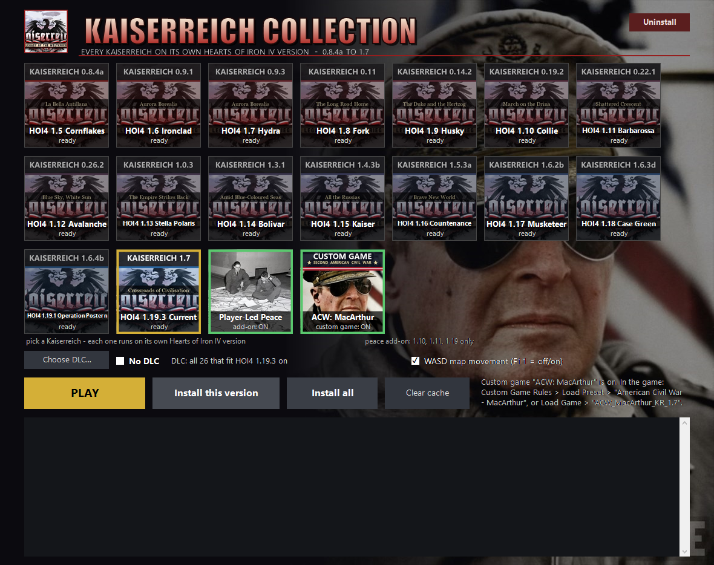

# Kaiserreich Collection

**Every Kaiserreich from 0.8.4a to 1.7, each running on the Hearts of Iron IV version it was made for. One window, one click.**

Old Kaiserreich releases only work on the HOI4 patch they were built for, and Steam lets you have only one HOI4 version installed. This launcher keeps a separate copy of each old HOI4 version, gives each one its matching Kaiserreich, and starts it. Your normal HOI4 and your Steam settings are left as they were.



## Download

### ⬇️ [Download Kaiserreich Collection 1.4.1 (zip, 15 MB)](https://github.com/Chessiehawk/Kaiserreich-Collection/releases/latest/download/Kaiserreich-Collection-1.4.1.zip)

Right-click the zip > **Extract All**, open the folder and double-click **`Kaiserreich Collection.exe`**. That's the launcher.

> **Have 1.4?** It was broken: every button ended in *"Something went wrong - read the log, fix it, and try again."* Download 1.4.1 and run it once. It replaces the installed launcher and moves the old 1.4 files from your Downloads and Desktop to the Recycle Bin. Your installed game versions stay.

Downloaded this whole page with the green **Code > Download ZIP** button instead? That works too: the launcher `Kaiserreich Collection.exe` and the two ACW save packs are in the top folder of it.

All the files are also on the **[release page](../../releases/latest)**:

| File | What it is |
|---|---|
| `Kaiserreich-Collection-1.4.1.zip` | **Everything in one file (15 MB).** Right-click > *Extract All*, then run `Kaiserreich Collection.exe` from the extracted folder. |
| `Kaiserreich.Collection.exe` | Or just the launcher (about 4 MB). Sets itself up the first time you run it. |
| `ACW-saves-1-of-2.7z`, `ACW-saves-2-of-2.7z` | *Optional, already in the zip:* ready saves for the **ACW: MacArthur** custom game. Leave them in your Downloads folder or next to the launcher and it picks them up on its own, with no unpacking needed. |

You need Windows 10 or 11, Steam, and Hearts of Iron IV on Steam.

## How to play

1. Have Steam open and logged in.
2. Double-click `Kaiserreich Collection.exe`.
3. Click the Kaiserreich you want (the picture tiles), then click **PLAY**.

**The first time you play a version, it installs itself:**
- Steam closes, reopens and downloads that old game version (about 1 GB). This is normal. Don't close the launcher window, and don't use Steam for those few minutes.
- The game is copied into its own folder (about 6-9 GB, on your D: drive if you have one), and the matching Kaiserreich is downloaded from the [official Kaiserreich GitHub](https://github.com/Kaiserreich/Kaiserreich-HOI4).
- Steam is then put back on the HOI4 version it was on before.

After that, the version starts instantly. A **Kaiserreich Collection** shortcut appears on your Desktop. Use it from then on.

**Install all** installs all 16 versions in one go: roughly 110 GB, taking a few hours. You don't need it, because PLAY installs only the version you picked.

## Versions

| Kaiserreich | HOI4 | HOI4 codename |
|---|---|---|
| 0.8.4a | 1.5 | Cornflakes |
| 0.9.1 | 1.6 | Ironclad |
| 0.9.3 | 1.7 | Hydra |
| 0.11 | 1.8 | Fork |
| 0.14.2 | 1.9 | Husky |
| 0.19.2 | 1.10 | Collie |
| 0.22.1 | 1.11 | Barbarossa |
| 0.26.2 | 1.12 | Avalanche |
| 1.0.3 | 1.13 | Stella Polaris |
| 1.3.1 | 1.14 | Bolivar |
| 1.4.3b | 1.15 | Kaiser |
| 1.5.3a | 1.16 | Countenance |
| 1.6.2b | 1.17 | Musketeer |
| 1.6.3d | 1.18 | Case Green |
| 1.6.4b | 1.19.1 | Operation Postern |
| 1.7 | 1.19.3 | Current |

HOI4 1.5 is the oldest version Steam still offers, so Kaiserreich releases older than 0.8 can't be played.

## Features

- **DLC per version.** Each version only gets the DLC that existed for it. Use **Choose DLC...** to pick, or tick **No DLC**.
- **Multiplayer.** Everyone must pick the same Kaiserreich tile and the same DLC. Different DLC means an out-of-sync error as soon as someone joins. Ticking **No DLC** is the easiest way to match. HOI4 1.5–1.7 have no reliable switch for turning DLC off, so on those versions the launcher moves DLC that is off out of its game copy, and the game can't load it.
- **ACW: MacArthur custom game.** A Second American Civil War with four sides, Canada staying out and Mexico going Sinarquista. Click the MacArthur tile so it says ON, pick your Kaiserreich, then PLAY. In the game, either:
  - start fresh: *Custom Game Rules > Load Preset > "American Civil War - MacArthur"*, or
  - skip ahead: *Load Game > "ACW_MacArthur_KR_&lt;version&gt;"*. This is a ready save as MacArthur's USA at the moment the country breaks apart, and it is put at the top of the save list. Every version has one. Kaiserreich 0.8.4a and 0.9.1 have no civil-war game rule, so for them it is save-only.
- **Player-Led Peace add-on.** An optional tile for HOI4 1.10, 1.11 and 1.19 that lets players run peace conferences themselves.
- **WASD map movement.** W/A/S/D scroll the map like the arrow keys while the game is in front. F11 turns it off and on.
- **Clear cache** and **Uninstall** buttons. Uninstall is also in Windows Settings > Apps.
- **Cleans up old downloads.** On start, older copies of this launcher and old `Kaiserreich-Collection-<version>.zip` downloads in your Downloads folder, on your Desktop or next to the launcher (and one folder down) go to the Recycle Bin, so an old copy can't put an old version back. It checks each exe's built-in program name and version, never just the file name. Game versions, mods and saves are never touched.

## Windows warnings

The launcher is a free fan project. It isn't code-signed, because that costs money every year, so Windows may be careful with it:

- **"Windows protected your PC"** (blue box): click **More info**, then **Run anyway**.
- **Windows Defender** sometimes flags new, unsigned programs that download and copy game files, with a machine-learning guess such as `Trojan:Win32/Wacatac.B!ml`. This is a false positive. All the source code is in this repository, so you can read it or build the exe yourself (see below). If it happens to you, open Windows Security > Protection history, pick the entry and choose **Allow on device**.

## What it does to your PC

Nothing is hidden, and all of it is in [`Kaiserreich-Collection.ps1`](Kaiserreich-Collection.ps1):

- **Installed files.** The launcher, game copies and mods go in one folder, `KaiserreichCollection` (on D: if you have one).
- **Old game versions.** To get an old version, it sets HOI4's beta branch in Steam's `appmanifest_394360.acf`, restarts Steam, waits for the download, copies the game, and switches Steam back. If anything is interrupted, it still knows the branch to restore.
- **Your normal HOI4.** Before a game starts, it backs up your `dlc_load.json`, `settings.txt` and game-rule presets. It puts them back when the game closes.
- **Mod list.** Mods are added to your HOI4 mod list as small `KRC_*.mod` pointer files, named "... [Kaiserreich Collection]".
- **Uninstall.** This removes all of the above.

## Building from source

You only need a stock Windows 10/11, which includes the .NET Framework C# compiler.

```powershell
powershell -ExecutionPolicy Bypass -File src\build.ps1            # -> dist\Kaiserreich Collection.exe
powershell -ExecutionPolicy Bypass -File src\build_savepacks.ps1  # -> dist\discord\ (exe + the two ACW save packs)
```

| Path | What it is |
|---|---|
| `Kaiserreich-Collection.ps1` | The engine: installs, launches, restores, uninstalls. |
| `src\CollectionGui.cs` | The launcher window. Everything in the project folder gets embedded into the exe. |
| `src\Wasd.cs` | WASD map movement (low-level keyboard hook, active only while HOI4 is in front). |
| `src\build_versions.ps1` | Generates `versions.json` / `versions.txt`: which HOI4 branch goes with which Kaiserreich, plus the DLC per version. |
| `src\build_scenarios.ps1` | Generates `scenarios.json` / `scenarios.txt`: the custom games, with only the game rules each Kaiserreich version has. |
| `scenario_saves\` | The ready ACW saves (`.hoi4.gz`). They are not in the repository because of their size, and ship as the two `.7z` release files. |

## Credits

- **[Kaiserreich](https://github.com/Kaiserreich/Kaiserreich-HOI4)** by the Kaiserreich Team. The mod and its artwork are theirs. The launcher downloads each release from their official GitHub.
- **Hearts of Iron IV** by Paradox Interactive.
- **[Player-Led Peace Conferences](https://steamcommunity.com/sharedfiles/filedetails/?id=846066944)** ([legacy version](https://steamcommunity.com/sharedfiles/filedetails/?id=2020606549)) from the Steam Workshop.
- **[7-Zip](https://www.7-zip.org/)** by Igor Pavlov, GNU LGPL. See [`7zip/License.txt`](7zip/License.txt).

This is an unofficial fan project, not affiliated with or endorsed by Paradox Interactive or the Kaiserreich Team.
